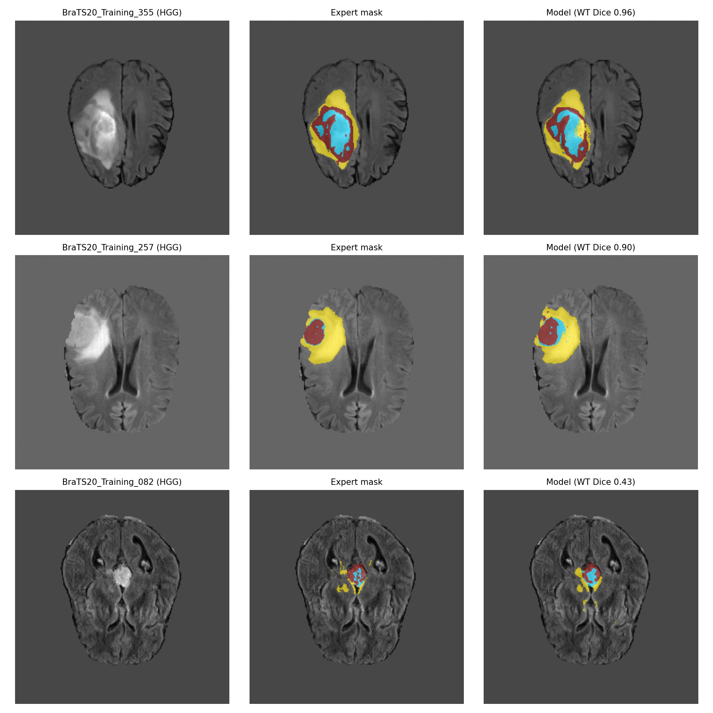
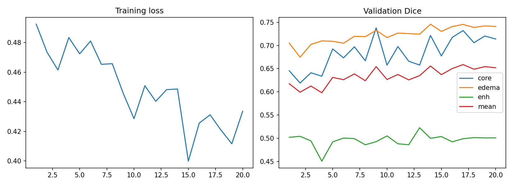

# 3D Brain Tumor Segmentation on BraTS2020 (MONAI 3D U-Net)

Automatic segmentation of glioma sub-regions from multi-sequence brain MRI, trained and evaluated with a patient-level split on the BraTS2020 dataset.

> **Research project, not a clinical tool.** It has not been validated for diagnosis or treatment planning.

*Best, median and worst test cases by whole-tumor Dice (top to bottom). Left to right: FLAIR, expert mask, model prediction. Colours: cyan = necrotic core, yellow = edema, dark red = enhancing tumor.*

## Why this project

Manually outlining a brain tumor in 3D is slow, and different specialists draw slightly different outlines. An automated first draft could save time and make outlines more consistent. These outlines matter for surgical planning, radiotherapy targeting and tracking how a tumor changes after treatment.

I am a radiography-trained professional with a self-taught machine learning background, and I built this project to work at the intersection of medical imaging and AI.

## Data

- **BraTS2020 training set:** 369 patients (293 high-grade glioma, 76 low-grade glioma).
- Each patient has four co-registered MRI sequences (**FLAIR, T1, T1ce, T2**) of size 240 × 240 × 155 voxels, plus an expert segmentation mask.
- **Mask labels:** 1 = necrotic/non-enhancing core, 2 = peritumoral edema, 4 = enhancing tumor (remapped to 3 for training).
- The validation set released with BraTS2020 has no public masks, so it was not used.
- **No scans or masks are included in this repository.** Get the data from the BraTS challenge or the Kaggle upload used here (*BraTS2020 Dataset (Training + Validation)* by Awsaf), and check the dataset's terms of use before using it.

## Approach

| Step | Details |
|---|---|
| Split | By **patient** (never by slice or patch), stratified by tumor grade: 258 train / 55 validation / 56 test |
| Preprocessing | Per-patient, per-sequence z-score normalisation over non-zero (brain) voxels |
| Input | 4-channel 3D patches of 96 × 96 × 96 voxels; 70% of patches centred on a tumor voxel, 30% random |
| Model | MONAI 3D U-Net, channels (16, 32, 64, 128, 256), 2 residual units per block, about 4.8M parameters |
| Loss / optimiser | Dice + cross-entropy (`DiceCELoss`), AdamW, mixed precision (fp16), batch size 2 |
| Training | Two stages, roughly one hour on a Kaggle T4 GPU in total (see below) |
| Inference | Sliding-window inference over the full volume, 25% overlap |

**Training in two stages.** In stage 1 (learning rate 1e-3) the loss became NaN at epoch 6, probably from fp16 overflow at a high learning rate (not confirmed). I kept the best checkpoint from before the collapse (validation Dice 0.591) and resumed in stage 2 with a lower learning rate (3e-4), gradient clipping (max norm 1.0) and a guard that skips any batch with a non-finite loss. The best checkpoint overall came from epoch 17 of stage 2.

## Results

Evaluated on **56 test patients** never used for training or for choosing the checkpoint. Scores use the standard BraTS regions: **WT** (whole tumor, labels 1+2+3), **TC** (tumor core, labels 1+3) and **ET** (enhancing tumor, label 3).

| Region | Mean Dice |
|---|---|
| WT | 0.868 |
| TC | 0.784 |
| ET | 0.790 |

Whole-tumor Dice has a median of 0.897; 6 of 56 patients scored below 0.70.

By tumor grade:

| Grade | Patients | WT | TC | ET |
|---|---|---|---|---|
| HGG | 44 | 0.875 | 0.840 | 0.838 |
| LGG | 12 | 0.840 | 0.582 | 0.529 |

Four LGG test patients have no enhancing tumor in the ground truth, so ET is averaged over 52 patients (8 of them LGG). Per-patient scores are in [`test_results.csv`](test_results.csv).

*Stage 2 (fine-tuning) training loss and validation Dice. The validation set used for these curves contains only 8 patients, so the scores fluctuate from epoch to epoch.*

## Failure analysis

I looked at the two lowest-scoring cases in detail by comparing predicted and expert voxel counts. In both, the model **over-segmented** instead of missing tumor.

- **Patient 082 (HGG, WT Dice 0.43):** the expert marked 10,101 tumor voxels and the model 30,312, mostly in the edema class (3,806 expert vs 21,459 predicted). Enhancing tumor was segmented well (Dice 0.77).
- **Patient 280 (LGG, core Dice 0.01, enhancing Dice 0.08):** the expert regions were tiny (135 core and 691 enhancing voxels). The model found nearly all of them but predicted far larger regions (25,968 core and 12,596 enhancing voxels).

A possible explanation for the LGG result is the training set's imbalance toward high-grade tumors (205 of 258 patients), but I did not test this.

## Limitations

- One split of 56 test patients, with only 12 low-grade cases, so the scores are noisy and a different split could shift them by a few points.
- The checkpoint was chosen using only 8 validation patients.
- Low-grade performance is clearly weaker (TC 0.58, ET 0.53 on average), with the average pulled down by a few patients.
- False positives on patients with no enhancing tumor were not measured.
- Small model with about one hour of training, no ensembling and no test-time augmentation, so scores are below published BraTS challenge winners. I have not compared against published results under identical conditions.
- Results are on BraTS2020 only; generalisation to other scanners, populations and protocols is untested.

## Notes on reading the images

*[Add your own notes here, in your own words: where the model agrees with the expert, where it fails, and what you notice about the tumor appearance on each sequence. Be clear about your level of experience, for example whether you have covered MRI interpretation yet.]*

## Next steps

- Class-balanced sampling or longer training to improve low-grade performance.
- Measure false positives on patients without enhancing tumor.
- Test generalisation on BraTS-Africa.

## How to run

The notebook was run on Kaggle (GPU T4 x2) with the BraTS2020 dataset attached as an input.

1. Open `[NOTEBOOK-FILE-NAME].ipynb` in a Kaggle notebook and attach the dataset.
2. Check that the `path` variable matches where Kaggle mounts the data.
3. Run the cells in order. Training takes roughly an hour.
4. One patient (`BraTS20_Training_355`) has its mask named `W39_1998.09.19_Segm.nii`; the notebook includes a patch that handles this.

Libraries: PyTorch, MONAI, nibabel, pandas, NumPy, scikit-learn, matplotlib. See `requirements.txt`.

## Repository contents

| File | Description |
|---|---|
| `[NOTEBOOK-FILE-NAME].ipynb` | Full pipeline with outputs |
| `test_results.csv` | Per-patient test Dice (WT, TC, ET) and tumor grade |
| `predictions.png` | Best / median / worst test cases |
| `curves.png` | Learning curves (stage 2) |

## Data citations

- Menze BH, et al. The Multimodal Brain Tumor Image Segmentation Benchmark (BRATS). *IEEE Transactions on Medical Imaging*, 2015.
- Bakas S, et al. Advancing The Cancer Genome Atlas glioma MRI collections with expert segmentation labels and radiomic features. *Scientific Data*, 2017.
- Bakas S, et al. Identifying the Best Machine Learning Algorithms for Brain Tumor Segmentation, Progression Assessment, and Overall Survival Prediction in the BRATS Challenge. *arXiv:1811.02629*, 2018.

## Author

**[YOUR NAME]** · [LinkedIn] · [Kaggle notebook link]
